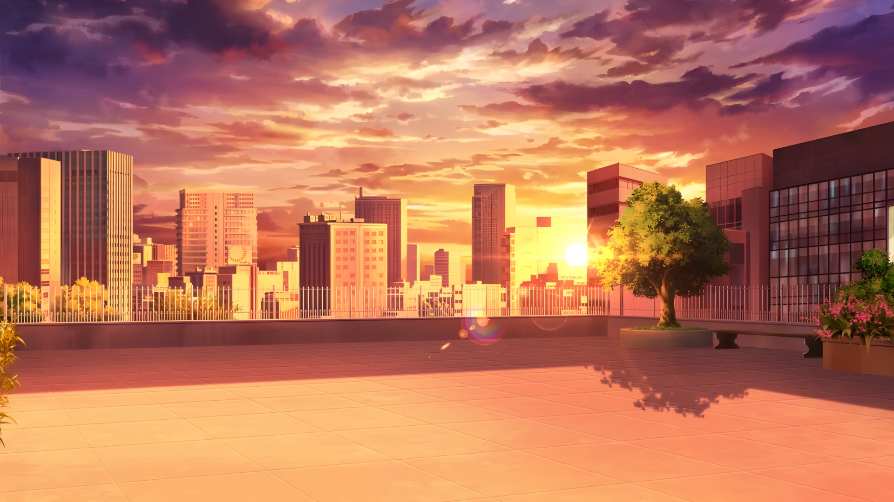
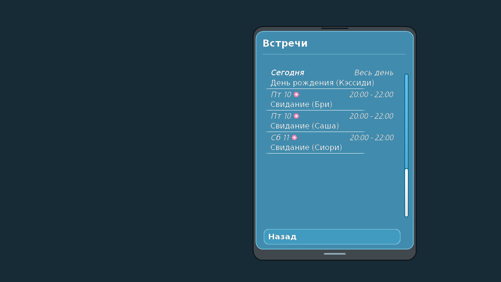
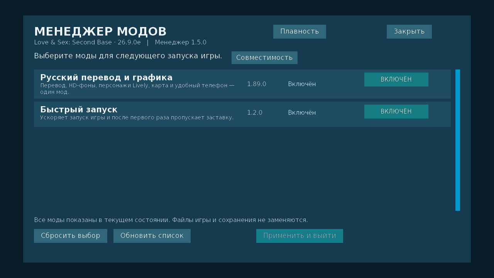
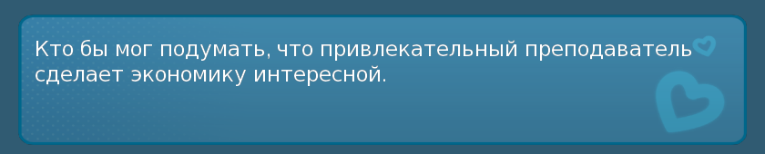
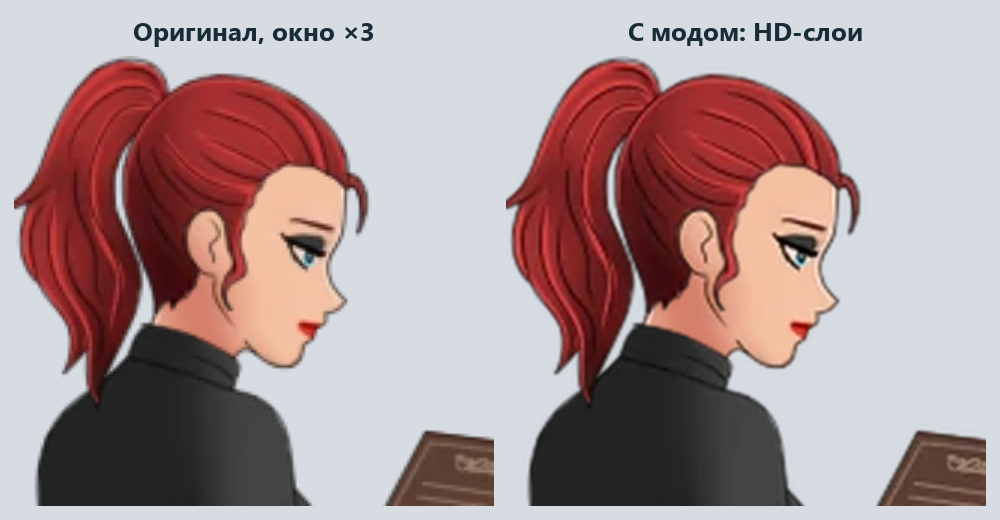

# LSSB · Русский перевод и графика

Русская локализация, HD-фоны, персонажи Lively и удобный телефон — **один мод**.

**[Скачать 1.91.1 · 1,57 ГБ](https://github.com/KPEKTYC/LSSB-Russian-Mods/releases/download/v1.91.1-own/LSSB_1.91.1_Russian_HD_Lively.zip)**
&nbsp; · &nbsp;
**[Установка и переход со старой версии](docs/INSTALL_RU.md)**

Проверено на **LSSB 26.10.0d для Windows** · Бесплатно

## Что входит в единый мод

- **Русский текст:** интерфейс, диалоги, события и ветки DLC Cupid.
- **HD-фоны и карты:** около 450 фоновых изображений и слоёв и миниатюры локаций в удвоенном разрешении.
- **Персонажи Lively:** 3 852 улучшенных слоя фигур, одежды и волос.
- **Расширенный телефон:** место для русских подписей, переведённые навыки, встречи и работа.

Перевод и графика устанавливаются одним RPA и включаются вместе.
Расширенный телефон входит в мод по умолчанию. Отдельной сборки перевода
со стандартным телефоном в этом выпуске нет.

Для игры нужен установленный оригинал LSSB; сама игра в комплект не входит.

## Установка

1. Скачайте ZIP и закройте игру.
2. Если установлена старая версия, перенесите прежние архивы перевода, отдельной графики
   и менеджера в резервную папку вне игры — точные имена есть в [инструкции](docs/INSTALL_RU.md).
3. Скопируйте файлы из папки `game` архива в папку `game` вашей LSSB.

Основной мод — `zzzzzz_lssb_localization_ru.rpa`. Менеджер и быстрый запуск
приложены как необязательные дополнения. Новое прохождение не требуется.

## Телефон и управление модами

Кнопка **«Моды»** открывает менеджер. Пункт **«Русский перевод и графика»**
отключает и включает обе части вместе после перезапуска игры.
Быстрый запуск управляется отдельно.

<strong>Перевод и персонажи</strong>

HD-изображения выбираются автоматически, когда окно игры больше 1280×720.
Самые маленькие лица сохраняют ограничения исходного рисунка.

## Что нового в 1.91.1

- Перевод для игры 26.10.0c и 26.10.0d: игра изменила пробелы после многоточий в 8 259 репликах,
  их переводы перенесены. Нужна игра 26.10.0c или новее.
- Переведены новые реплики, варианты ответа, SMS, подсказки шкал характеристик и тексты трекера.
- Экраны выбора, подсказок, телефона, карточки персонажа и карт обновлены под новую игру.
- Удалены 43 172 мёртвых блока перевода; скрипты загружаются быстрее.

[Журнал изменений](CHANGELOG.md) ·
[Страница выпуска](https://github.com/KPEKTYC/LSSB-Russian-Mods/releases/tag/v1.91.1-own)

## Совместимость

| Компонент | Версия |
| --- | --- |
| Русский перевод и графика | 1.91.1 |
| Менеджер модов | 1.5.1 |
| Быстрый запуск | 1.3.0 |

Проверено на LSSB 26.10.0d для Windows. Перевод, телефон, графика и менеджер
проверены в игре; полного прохождения всех сюжетов не выполнялось.
Подробности проверок — в [документации для разработчиков](docs/DEVELOPMENT.md).

[Сообщить об ошибке](https://github.com/KPEKTYC/LSSB-Russian-Mods/issues).
Укажите версию игры и шаги воспроизведения. Перед публикацией скриншота
или журнала уберите личные данные; сохранения публично не прикладывайте.

[Для разработчиков](docs/DEVELOPMENT.md) · [Для авторов модов](docs/AUTHOR_MODS_RU.md)

## Поддержать автора

Локализация и обновления остаются бесплатными.

Бесплатное некоммерческое использование с сохранением авторства **KPEKTYC**.
[Условия использования](LICENSE_SCOPE.md). Права на игру и её графику принадлежат
их правообладателям. Добровольная поддержка не даёт платных функций или раннего доступа.
