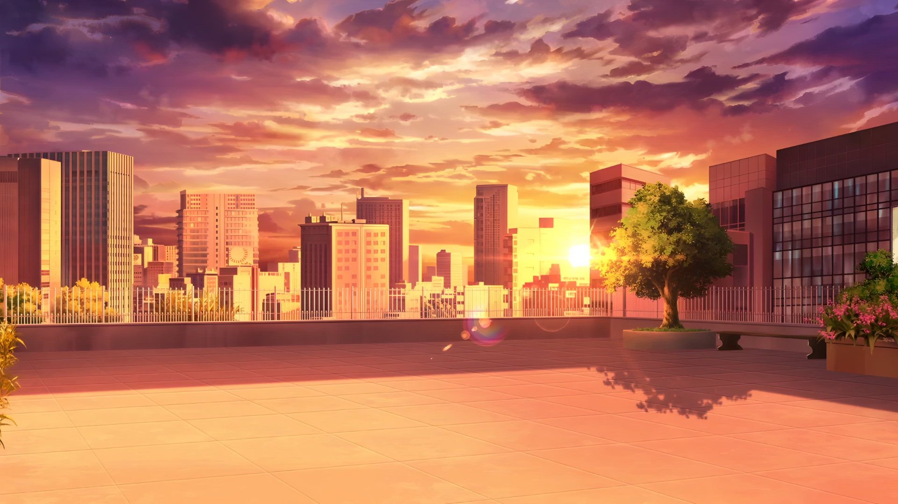
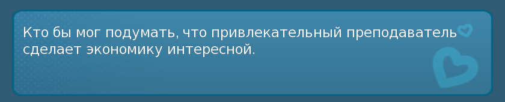
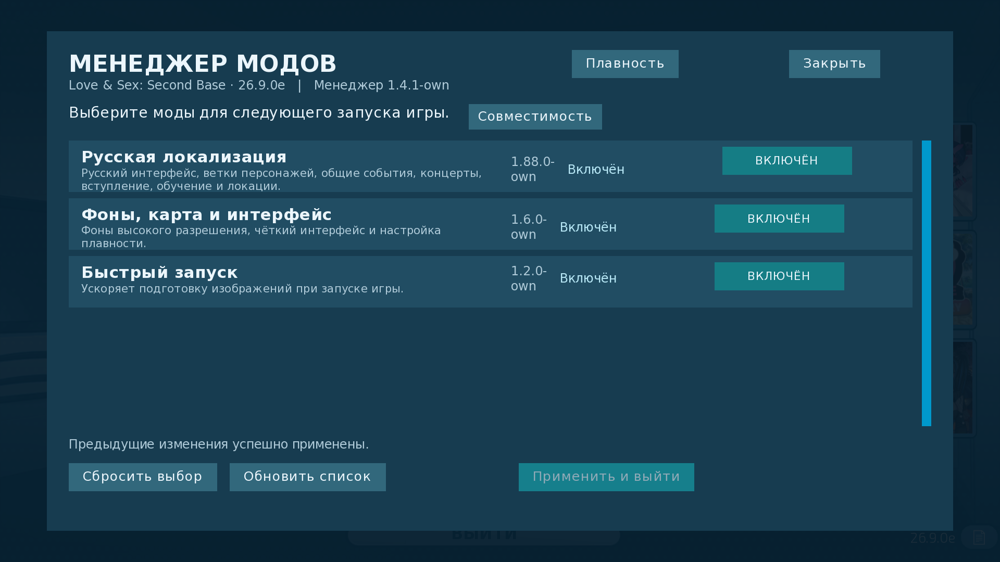

# LSSB · На русском и в высоком разрешении

Русский перевод **Love & Sex: Second Base**, обновлённые фоны и удобное управление модами.

**[Скачать полный комплект · 1,27 ГБ](https://github.com/KPEKTYC/LSSB-Russian-Mods/releases/download/v1.88.0-hd.1-own/LSSB_Mods_1.88.0_HD_2026-10-25.zip)**
&nbsp; · &nbsp;
**[Только русификатор](https://github.com/KPEKTYC/LSSB-Russian-Mods/releases/download/v1.88.0-hd.1-own/LSSB_Russian_1.88.0.zip)**
&nbsp; · &nbsp;
**[Установка](docs/INSTALL_RU.md)**

Комплект **1.88.0 HD** · Проверено на **LSSB 26.9.0e для Windows** · Бесплатно

## Что внутри

- **Русский текст.** Интерфейс, диалоги и события, включая оставшиеся ветки DLC Cupid.
- **Более чёткие фоны.** 358 фоновых изображений и слоёв в удвоенном разрешении; улучшенные городские карты сохранены.
- **Удобное меню «Моды».** Список появляется сразу, пока проверка файлов идёт в фоне.
- **Быстрый запуск.** Оптимизация подготовки изображений уже включена в комплект.

Можно установить только перевод или выбрать дополнительные улучшения отдельно.
Для игры нужен установленный оригинал LSSB; сама игра в комплект не входит.

## Начать играть

1. Скачайте комплект или отдельный русификатор по ссылкам выше и закройте игру.
2. Скопируйте нужные файлы из папки `game` в папку `game` вашей LSSB. При обновлении сначала сохраните прежние файлы модов вне игры.
3. Запустите игру: русский язык включится автоматически. Дополнительные компоненты доступны через кнопку **«Моды»**.

[Подробная установка, обновление и удаление →](docs/INSTALL_RU.md)

HD-фоны используются автоматически, когда окно игры больше 1280×720.
Оригинальные архивы игры заменять не требуется.

<strong>Посмотреть русский текст и меню модов</strong>

Выберите компоненты, нажмите **«Применить и выйти»** и запустите игру снова.
Пока идёт проверка файлов, переключатели временно недоступны.

## Что нового

В **1.88.0 HD** добавлены фоны повышенного разрешения и ускорено открытие меню модов.
Перевод **1.88.0** включает 7 528 реплик десяти веток Cupid и 140 строк меню.

[Скачать выпуск и прочитать изменения →](https://github.com/KPEKTYC/LSSB-Russian-Mods/releases/tag/v1.88.0-hd.1-own)

## Обратная связь

[Сообщить об ошибке](https://github.com/KPEKTYC/LSSB-Russian-Mods/issues).
Укажите версию игры, что произошло и как это повторить. Перед отправкой скриншота
или журнала уберите личные данные и пути к папкам; сохранения публично не прикладывайте.

---

<strong>Версии, совместимость и результаты проверок</strong>

| Компонент | Версия |
| --- | --- |
| Русская локализация | 1.88.0 |
| Фоны, карта и интерфейс | 1.6.0 |
| Менеджер модов | 1.4.1 |
| Быстрый запуск | 1.2.0 |

Проверено на LSSB 26.9.0e / Ren’Py 8.5.3.26051504, Windows.
Все 358 новых изображений загружены и отрисованы в игре; проверены сохранение,
загрузка и переключение модов. Полное прохождение всех сюжетов не выполнялось.
Обновления самой игры могут потребовать обновления модов.

[Подробности HD и меню](docs/HD_MENU_2026-10-25.md) ·
[Измерения запуска](docs/STARTUP_1.2.0.md) ·
[Об адаптации текста](docs/INSTALL_RU.md#об-адаптации-текста)

<strong>Для разработчиков и авторов модов</strong>

[Сборка и технические проверки](docs/DEVELOPMENT.md) ·
[Подключение сторонних модов](docs/AUTHOR_MODS_RU.md)

Бесплатное некоммерческое использование с сохранением авторства **KPEKTYC**.
[Условия использования](LICENSE_SCOPE.md). Права на игру и её графику принадлежат
их правообладателям. Добровольная поддержка не даёт платных функций или раннего доступа.
